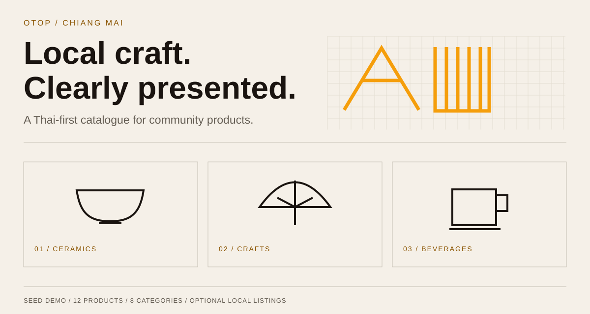

# OTOP Chiang Mai

**A Thai-first catalogue for Chiang Mai's community products.**



Browse a craft-focused storefront with product discovery, category filters, a province map, product pages, and illustrative analytics. The repository also contains a local listing form and optional LINE/Telegram ingestion code that can use Gemini to extract product details into Supabase.

> **Demo, not a live marketplace.** The default catalogue contains 12 sample products across eight categories. Seed ratings, reviews, view counts, and analytics are invented examples. There is no checkout, payment processing, or verified seller service. The app keeps its demo banner and labels visible.

## Try the demo: no keys, database, or bot required

Use Node.js 24 (see `.nvmrc`) and npm. The dependency tree requires Node 22 or newer.

```bash
git clone https://github.com/Nonarkara/otop-chiangmai.git
cd otop-chiangmai/web
npm ci --ignore-scripts
npm run dev -- --hostname 127.0.0.1
```

Open `http://127.0.0.1:3000`. Do **not** create an environment file for the default demo. MapLibre uses CARTO tiles without a map token; map tiles and Google Fonts still need network access.

To preview the static production export locally:

```bash
npm run build
npm start
```

`npm start` serves `web/out` at `http://127.0.0.1:3000`, including clean product URLs. Stop the dev server before starting the preview. This lightweight server is for local review, not production hosting.

## What can run today

| Mode | What works | What you supply |
| --- | --- | --- |
| Seed demo | Catalogue, filters, map, sample details/reviews, illustrative analytics | Node + npm; network for fonts/map |
| Local manual listings | `/submit` on localhost → local Express API → Supabase → catalogue | Dedicated local Supabase database and local keys |
| Chat ingestion prototype | LINE/Telegram adapters → job queue → Gemini extraction → product insert | Your own bot credentials, Gemini key, Supabase, webhook/polling setup, integration fixes and verification |

The local form is visible on loopback hosts, but saving requires the optional API/database. It returns a clear error when the database is not configured. Live manual rows and seed examples are combined; the analytics page still uses seed data.

## Architecture


- **`web/`:** Next.js 16 App Router, React 19, TypeScript, Tailwind 4, and MapLibre; `output: 'export'`
- **`bot/`:** Node/Express, LINE SDK, Telegraf, Gemini, Supabase-backed inbox and job queue
- **`supabase/schema.sql`:** database bootstrap for categories, districts, products, sellers, reviews, and bot jobs

[Architecture and source map →](docs/ARCHITECTURE.md)

## Choose your next step

- [Run the no-key demo or troubleshoot local preview](docs/SETUP.md#seed-demo)
- [Add a dedicated local database and manual listings](docs/SETUP.md#optional-local-listings)
- [Understand the bot credentials and production gaps](docs/SETUP.md#optional-chat-ingestion)
- [See exactly what was verified](docs/VERIFICATION.md)

## Commands

Run from `web/` unless indicated otherwise.

| Command | Purpose |
| --- | --- |
| `npm ci --ignore-scripts` | Install the committed dependency versions without lifecycle scripts |
| `npm run dev -- --hostname 127.0.0.1` | Local Next development server |
| `npm run typecheck` | TypeScript check; this is not lint |
| `npm test` | Local static-preview server regression tests |
| `npm run build` | Generate `web/out`; no environment variables required |
| `npm start` | Preview the generated export on loopback |
| `cd ../bot && npm ci --ignore-scripts && npm start` | Optional Express process; disabled integrations with empty credentials |

No lint tool is configured. The previous `next lint` script was removed because Next 16 does not provide that command. Tests currently cover the local preview server; they are not full application or integration tests.

## Design and honesty

The existing Lanna-minimal visual language is preserved: paper cream, dark ink, restrained amber, sharp edges, thin rules, and Thai-first typography. The documentation's original SVG artwork is editable and is a schematic illustration rather than an application screenshot.

Keep [`DemoStrip`](web/src/components/DemoStrip.tsx), sample labels, truthful metadata, and the closed-channel notices. AI-generated scores and stars must not be described as official OTOP certification or real buyer evidence.

## Production and reuse

- The bot/API is development infrastructure. Public launch needs authentication/authorization, abuse protection, input/output safety review, webhook verification, and end-to-end testing
- Never put a Supabase service-role key in a `NEXT_PUBLIC_*` variable. The web key is public; server secrets stay in `bot/.env`
- `context.md` contains historical maintainer deployment notes, not a portable setup guide. In particular, the `otop` Pages project refers to a different national registry. Do not copy old DNS/deployment commands
- No repository-wide license is included. Public visibility alone does not grant reuse or redistribution rights. Map attribution and other third-party terms also remain applicable
