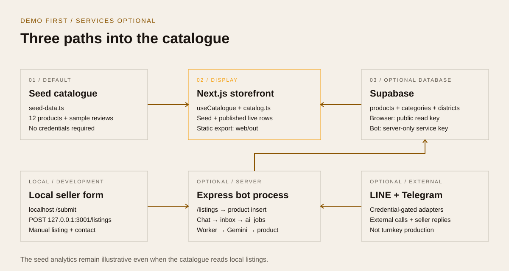

# Architecture and source map

The diagram describes the code paths that exist. Optional integrations are not a claim of a deployed service.

## 1. Default seed path

[`web/src/lib/seed-data.ts`](../web/src/lib/seed-data.ts) supplies 12 products, eight categories, and sample reviews. [`useCatalogue.ts`](../web/src/lib/useCatalogue.ts) combines those products with any optional live rows, deduplicating by slug. The seed path works without environment variables.

The home, catalogue, details, and province map display the resulting data. [`analytics/page.tsx`](../web/src/app/analytics/page.tsx) explicitly computes from seed products/categories; adding a database does not convert this dashboard into live business analytics.

[`DemoStrip.tsx`](../web/src/components/DemoStrip.tsx), page labels, and [`layout.tsx`](../web/src/app/layout.tsx) describe the demonstration status. Seed category counts, ratings, reviews, and scores must be treated as illustrative, not measured activity.

## 2. Local manual-listing path

1. [`submit/page.tsx`](../web/src/app/submit/page.tsx) exposes a form only when the browser hostname is `localhost` or `127.0.0.1`
2. The form posts product name, price, category, district, description, and contact to `http://127.0.0.1:3001/listings`
3. [`listings.handler.js`](../bot/src/handlers/listings.handler.js) validates basic fields, resolves category/district IDs, and inserts a published manual product using the server Supabase service
4. [`catalog.ts`](../web/src/lib/catalog.ts) reads published rows with related categories and districts through the browser's anonymous key. [`supabase.ts`](../web/src/lib/supabase.ts) prevents a public page from attempting to call a loopback database
5. [`listing/page.tsx`](../web/src/app/listing/page.tsx) finds a live row by a query-string slug. It avoids needing a new statically generated route per manual listing

There is no order pipeline. The product action is a contact when one exists; seed cards have no real contact.

## 3. Optional chat/AI path

[`line.handler.js`](../bot/src/handlers/line.handler.js) and [`telegram.handler.js`](../bot/src/handlers/telegram.handler.js) register credential-gated adapters. Incoming image/text content is passed to [`productStore.js`](../bot/src/services/productStore.js), which creates `bot_inbox` and `ai_jobs` rows.

[`messageQueue.service.js`](../bot/src/services/messageQueue.service.js) polls pending jobs, marks one as processing, invokes [`ai.service.js`](../bot/src/services/ai.service.js), saves extracted product data, and sends a platform reply. The AI service contains hard-coded Gemini model IDs and prompts for Thai/English descriptions, category, prices, and model-generated scores.

This path has gaps: a missing database does not create a working local queue; the text parser in `utils/extractProduct.js` is not a full no-Gemini fallback in the worker; product insert failure handling and successful-publish replies need end-to-end review; generated chat-product slugs are not included in the seed-only static routes. See [setup](SETUP.md#optional-chat-ingestion).

## Build and hosting boundary

[`web/next.config.ts`](../web/next.config.ts) sets `output: 'export'`. The only dynamic path generator, [`products/[slug]/page.tsx`](../web/src/app/products/%5Bslug%5D/page.tsx), enumerates seed product slugs at build time. Client components can later read a configured database, but the export does not contain Next.js API routes or a running Node server.

`web/out` is static site output. The bot is a separate long-running Express process and is not included in a Pages upload. `web/scripts/serve-export.mjs` is a local preview utility, not the bot or a production Next runtime.

## Database boundary

[`supabase/schema.sql`](../supabase/schema.sql) defines categories, districts, sellers, products, reviews, bot inbox/jobs/outbox, triggers, functions, grants, and RLS policies. Public read access is provided for published products, categories, districts, and reviews. The server uses a service-role key for privileged operations.

The SQL is a one-time bootstrap against the default `public` schema. The file does not create a custom `otop` schema or manage migrations. `bot_outbox` exists in the schema and service helpers, but the current queue worker sends replies directly rather than delivering them through a durable outbox processor.

## Visual identity

[`globals.css`](../web/src/app/globals.css) defines cream `#f5f0e8`, ink `#1a1410`, and amber `#f59e0b`; typography includes Josefin Sans, Source Sans 3, and IBM Plex Sans Thai. The new documentation SVGs use the same palette, thin rules, and square geometry, without changing application styling.
